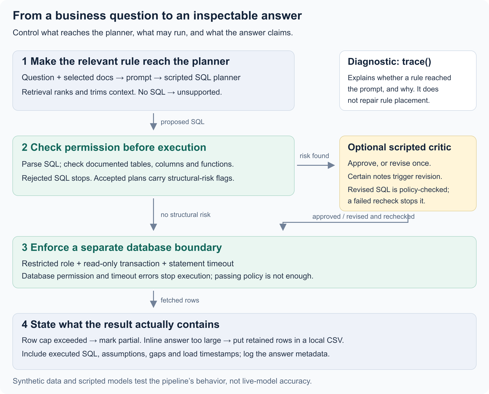
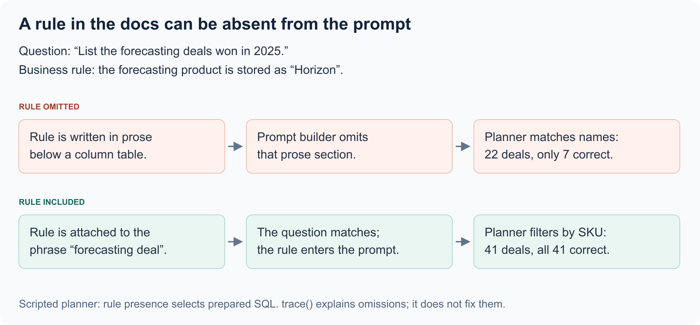

> **This is an example repo, not a library.** It exists to show one idea from an internal
> system, rebuilt over synthetic data so the idea can be read and run. It is not maintained
> as a dependency, not hardened for production, and the data in it is invented. Study the concepts;
> code reuse requires permission.

# Ask the warehouse

## Situation

Someone asks, **“Which deals did we win in 2025 that included our forecasting product?”** The database calls that product **Horizon**.

A person who knows the business can make that connection. An assistant needs it explained before it can write the right SQL. Similar questions depend on other business definitions: does “signed this year” mean a first purchase or a renewal? Who owns an account that is still a prospect?

An LLM (large language model) can turn a question like this into SQL. This example explores the surrounding system: how to give the model the right business definitions, check its proposed query, and present the results.

## Complication

Each step can lose something important. The documentation may explain Horizon, but the assistant never receives that paragraph. A query may run successfully while counting renewals as new customers. A response may show 1,000 rows without saying that more matched.

The service therefore checks **what information reached the query writer, what the query is allowed to do, and what the results actually cover.**

## Our Answer

The design separates the model's work into two roles: a **planner** proposes SQL, and a **critic** reviews selected queries before they run.

| Part | Job in the flow |
| --- | --- |
| Retrieval | Select database documentation and business definitions for the question. |
| Planner | Use the question and that context to propose SQL, with assumptions and missing information. |
| SQL checks | Check which tables, columns, and operations the query uses. |
| Critic | Review queries flagged by the checks and return a verdict and notes. If revision is requested, the planner revises once and SQL checks run again. |
| Database and answer handling | Execute with restricted permissions, then return the results and identify missing or omitted data. |

The planner and critic are model roles, not necessarily separate LLMs. In this repository, `Model.plan()`, `Model.review()`, and `Model.revise()` define those operations. `ScriptedModel` supplies prepared responses so the examples run repeatably without an LLM API connection. The flow is implemented in [ask.ts](src/ask.ts), and the model interface and example responses are in [model.ts](src/model.ts).

### 1. Give the assistant the business definitions it needs

Searching sales notes for “forecasting” finds conversations where the product was discussed but never purchased. To answer the question, the query must instead check which deals won in 2025 include **Horizon** in their product list.

The demonstration makes this difference visible. It chooses between two prepared queries according to whether the prompt—the question and documentation supplied to the query writer—includes the product-name explanation:

| Information supplied | Query looks at | Result in the example |
| --- | --- | --- |
| No explanation of Horizon | “Forecast” in deal names and notes | 22 deals returned; only 7 belong in the answer |
| Forecasting means Horizon | Horizon in the products on each won deal | All 41 correct deals returned |

The explanation goes missing because the service sends selected documentation, not the entire database manual. It ranks views by word matches, giving rarer words more weight. Only the top three keep descriptions. Column descriptions require matching column names; free-form prose is omitted entirely.

A **concept** connects phrases a user might say to a rule and its database column. Matching “forecasting deal” includes the Horizon rule even if its view ranks lower. But “forecasting customer” does not match “forecasting deals,” so choosing the right phrases matters.

`trace(question, docs, rule)` explains why a rule was included or omitted. Tests verify that explanation against the prompt and track prompt size: adding documentation should help relevant questions without filling unrelated prompts.

Some definitions are better expressed directly in a database view. For example, a prospect's account owner comes from its latest open deal; other accounts use the owner on their account record. The `account_owner` column applies that rule once, so each query can read the answer without rebuilding the same joins and conditions.

[Retrieval and tracing](src/retrieve.ts) · [Business definitions in SQL](src/schema.sql)

### 2. Check the query before running it

The service parses proposed SQL into a syntax tree and checks its tables, columns, functions, and operations. Allowed views and columns come from the full documentation catalog, independently of the excerpts selected for the prompt.

A query for staff compensation from `raw.staff`, for example, is refused because that table is not exposed. `SELECT *` is also refused: naming columns explicitly lets the service check exactly what the query reads. `count(*)` is allowed because it counts rows without requesting every column.

PostgreSQL enforces a second boundary: a restricted role, a read-only transaction, and a five-second timeout. It can refuse access or writes even if the earlier check misses something.

But permission is different from correctness. Consider **“How many customers signed in 2024 and churned?”** Counting won deals from 2024 includes renewals by customers who first signed earlier. The example returns **19** instead of **8**.

A review step—the **critic**—examines queries with joins, aggregates, windows, date boundaries, or set operations. In this case, its note identifies `customer_since` as the first-signing date, yet its verdict approves the original query. The service therefore checks the notes too: when a note names a known underscore-separated column such as `customer_since` that the query does not read, it requests one revision and checks the replacement SQL before execution.

This is a specific, testable correction rule. Reviewing only these query shapes reduces review calls, but a simple query can still use the wrong column. Correctness therefore also needs evaluation against known answers.

[SQL checks](src/policy.ts) · [Database permissions](src/execute.ts) · [Review and revision](src/ask.ts)

### 3. Make incomplete answers visible

A reader may see fewer rows because the service stopped fetching or because it shortened the response. These need different treatment.

| What happened | How the service handles it |
| --- | --- |
| More rows match than the fetch limit allows | Request one extra row to detect overflow, retain the allowed rows, and mark the answer `answered_in_part`. |
| The fetched results are too large to include in the response | Show a subset and provide a CSV containing all retained rows. |

The default fetch limit is 10,000 rows; the demo uses 1,000. A CSV cannot restore rows excluded by this limit, so the user needs to narrow the question.

Separately, the response targets 48,000 bytes, storing column names once rather than repeating them for every row. In the 4,000-row usage example, 735 rows fit in the response and all 4,000 are available in the CSV.

The answer also includes the SQL that ran, assumptions, missing information, and source load times. If someone requests a customer satisfaction score that the warehouse does not contain, the response identifies that gap alongside the data it can provide.

Evaluation then checks the answers: 14 questions have independent reference queries over raw tables, and two expect the request to be reported as unsupported. Comparisons include duplicate rows and distinguish correct, partial, unsupported, and wrong outcomes. A query passing its execution checks is only useful if it answers the question.

[Answer packaging](src/answer.ts) · [Evaluation](src/eval.ts)

## Why this matters to users

- **Ask questions without learning the database.** Users can ask about the “forecasting product” while shared context supplies the product name and fields needed to query it.
- **Spend less effort explaining each question.** Business definitions are maintained centrally, so related questions can build on the same context rather than requiring users to restate it.
- **Get answers that are easier to verify.** The response includes the SQL that ran, its assumptions, and the available results, giving users a way to investigate a surprising answer.
- **Know how to follow up.** Missing fields and row limits are made explicit, so users can distinguish a question that needs narrowing from results that are simply available in a download.

## Explore the example

[Run it](docs/running.md) · [Implementation and tradeoffs](docs/mechanisms.md) · [Detailed limits](docs/limits.md)

Copyright © 2026 Geoffrey Lew. All rights reserved.
